<picture>
  <source media="(prefers-color-scheme: dark)" srcset="https://raw.githubusercontent.com/bilal-773/bilal-773/main/dark.svg?v=2">
  <source media="(prefers-color-scheme: light)" srcset="https://raw.githubusercontent.com/bilal-773/bilal-773/main/light.svg?v=2">
  
</picture>

<!-- Stats cards: replace YOUR-INSTANCE with your Vercel URL, then delete this comment line and the closing one below.
 

-->

<picture>
  <source media="(prefers-color-scheme: dark)" srcset="https://raw.githubusercontent.com/bilal-773/bilal-773/output/github-snake-dark.svg" />
  <source media="(prefers-color-scheme: light)" srcset="https://raw.githubusercontent.com/bilal-773/bilal-773/output/github-snake.svg" />
  
</picture>

&nbsp;&nbsp;

&nbsp;&nbsp;

&nbsp;&nbsp;

&nbsp;&nbsp;

